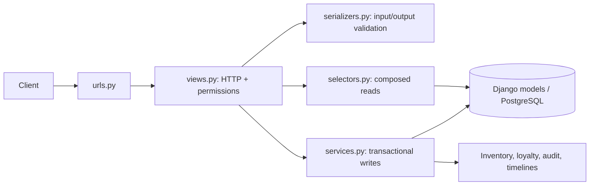
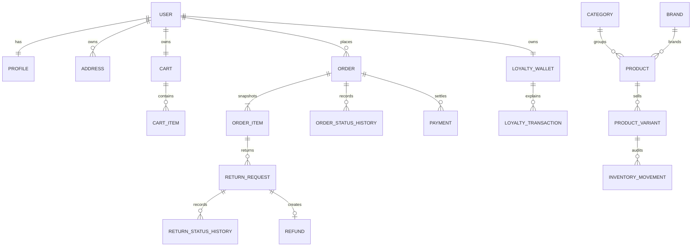

# E-commerce API

A learning-focused, API-first backend for a single-vendor store. The project demonstrates a maintainable Django modular monolith: catalog and SKU inventory, authenticated carts, transactional checkout, coupons, loyalty accounting, COD payments, returns, cash refunds, reviews, notifications, audit logs, and staff reports.

This is a portfolio project, not an independently audited production service. Card gateways, tax engines, background workers, and external refund rails are intentionally not represented as working.

## Stack

- Python 3.12, Django 5.2 LTS, Django REST Framework 3.16
- Simple JWT, drf-spectacular, django-filter, django-cors-headers
- PostgreSQL 17 reference database; psycopg 3
- pytest/pytest-django, Coverage, Ruff
- Docker Compose; `uv` dependency management

Exact resolved versions are in `uv.lock`.

## Implemented features

- Custom Django user with database-unique normalized email, username-based JWT login, refresh rotation, logout blacklist, password change/reset, profiles, and owned addresses.
- Hierarchical categories, brands, products, images, variants/SKUs, search/filter/order/pagination, wishlist, verified reviews, and moderation.
- Variant stock as the single source of truth, signed inventory movement audit, locked staff adjustments, checkout deduction, cancellation and return restoration.
- Persistent carts, address-aware shipping methods, non-binding quote, Decimal pricing, atomic idempotent checkout, immutable purchase/address/shipping snapshots.
- Coupons with time windows, fixed/percentage discounts, caps, eligibility, global/per-user limits, and cancellation release.
- Loyalty wallet plus append-only event ledger, redemption, earning, cancellation reversal, return recredit/clawback, outstanding debt, and staff adjustments.
- Explicit order timeline, COD payment collection, partial returns, return timeline, pending cash refunds, idempotent completion, notifications, audit log, and staff reports.

## Architecture

The backend is a modular monolith with three deliberately broad Django apps:

| App | Responsibility |
|---|---|
| `account` | User, profile, addresses, authentication endpoints, notifications, audit log |
| `product` | Catalog, SKUs, product media, inventory movements, reviews, wishlist |
| `order` | Cart, shipping, quote/checkout, orders, coupons, loyalty, COD, returns/refunds, reporting |

Each responsibility has one canonical implementation: `models.py`, `serializers.py`, `views.py`, `services.py`, `selectors.py`, `urls.py`, and `tests/` where relevant. There are no legacy API modules, wildcard model imports, or `v2` files.



Critical financial and inventory mutations use `transaction.atomic()` and row locks. Views do not accept trusted prices, balances, stock, totals, or payment state from clients. See [Architecture](docs/ARCHITECTURE.md), [Database](docs/DATABASE.md), and [Business rules](docs/BUSINESS_RULES.md).

## Project structure

```text
backend/
├── account/
│   ├── models.py, serializers.py, views.py, urls.py
│   ├── signals.py, admin.py, tests/
├── product/
│   ├── models.py, serializers.py, views.py, services.py, urls.py
│   ├── management/commands/seed_demo_store.py, tests/
├── order/
│   ├── models.py, serializers.py, views.py, services.py
│   ├── selectors.py, urls.py, admin.py, tests/
├── emarket/                  settings, root URLs, exception contract
├── docs/                     design and learning references
├── schema.yml                generated OpenAPI artifact
├── docker-compose.yml, Dockerfile
├── pyproject.toml, uv.lock
└── manage.py
```

## Data model overview



Full constraints, indexes, deletion policies, and field meanings are documented in [DATABASE.md](docs/DATABASE.md).

## Local setup

### Windows PowerShell

```powershell
Set-Location backend
Copy-Item .env.example .env
# Replace DJANGO_SECRET_KEY before non-local use.
docker compose up -d db
uv sync --all-groups
uv run python manage.py migrate
uv run python manage.py createsuperuser
uv run python manage.py seed_demo_store
uv run python manage.py runserver
```

### Bash

```bash
cd backend
cp .env.example .env
docker compose up -d db
uv sync --all-groups
uv run python manage.py migrate
uv run python manage.py createsuperuser
uv run python manage.py seed_demo_store
uv run python manage.py runserver
```

For lightweight exploration only, set `DB_ENGINE=django.db.backends.sqlite3` and `DB_NAME=db.sqlite3`. SQLite does not validate row-locking guarantees.

## Environment variables

| Variable | Purpose | Local example |
|---|---|---|
| `DJANGO_SECRET_KEY` | JWT/Django cryptographic secret | replace generated placeholder |
| `DJANGO_DEBUG` | Debug mode | `true` locally |
| `DJANGO_ALLOWED_HOSTS` | Exact accepted hosts | `localhost,127.0.0.1` |
| `DJANGO_TIME_ZONE` | Display/application zone | `Africa/Cairo` |
| `DB_ENGINE` | Database backend | `django.db.backends.postgresql` |
| `DB_NAME/USER/PASSWORD/HOST/PORT` | PostgreSQL connection | see `.env.example` |
| `CORS_ALLOWED_ORIGINS` | Exact React origins | Vite localhost origins |
| `EMAIL_BACKEND` and SMTP variables | Password-reset delivery | console locally |
| `DEFAULT_FROM_EMAIL` | Sender identity | configured production sender |

Never commit `.env`. The checked-in `.env.example` contains local-only placeholders.

## Authentication and API

Base URL: `/api/v1/`. Access tokens use `Authorization: Bearer <token>`. Access lifetime is 15 minutes; refresh tokens rotate and are blacklisted after rotation/logout. Registration requires a unique normalized email while login uses username and password.

Key endpoint groups:

- `/auth/`, `/users/addresses/`, `/notifications/`
- `/catalog/categories/`, `/catalog/brands/`, `/catalog/products/`
- `/wishlist/`, `/cart/`, `/shipping/methods/`
- `/checkout/preview/`, `/checkout/`, `/orders/`
- `/coupons/validate/`, `/loyalty/`
- `/orders/returns/`, `/admin/payments/`, `/admin/refunds/`
- `/admin/catalog/`, `/admin/loyalty/`, `/admin/reports/`

Collections use page-number pagination. Product reads support search, category/brand/price/availability filters, and validated ordering. Detailed endpoints, fields, errors, and roles are in [API_REFERENCE.md](docs/API_REFERENCE.md); complete flows are in [API_EXAMPLES.md](docs/API_EXAMPLES.md).

- Swagger UI: `http://localhost:8000/api/docs/`
- Runtime schema: `http://localhost:8000/api/schema/`
- Generated schema: `schema.yml`

## Core workflows

Checkout locks the user, cart, cart lines, variants in deterministic ID order, shipping method, coupon, and wallet. It recalculates all money, creates immutable order snapshots, deducts stock, consumes coupon/points, creates COD payment and timeline records, clears the cart, then schedules notifications after commit. `Idempotency-Key` returns the original order for identical retries and rejects a conflicting payload.

Pricing order is merchandise subtotal → coupon → loyalty → shipping → zero v1 tax. Ten points redeem for 1 EGP; one point is earned per 10 eligible paid EGP, rounded down, only after delivered + paid. Cancellation and returns are idempotent ledger events. See [BUSINESS_RULES.md](docs/BUSINESS_RULES.md).

## Tests and quality

```powershell
uv run python manage.py check
uv run python manage.py makemigrations --check --dry-run
uv run pytest
uv run coverage run -m pytest
uv run coverage report -m
uv run ruff check account product order emarket
uv run ruff format --check account product order emarket
uv run python manage.py spectacular --file schema.yml --validate
```

CI runs against PostgreSQL 17. Concurrency tests use real transactions and skip on SQLite. See [TESTING.md](docs/TESTING.md).

## Database reset for this learning project

The committed first-party migrations describe a fresh schema. To reset a positively identified disposable local Compose database:

```powershell
docker compose down -v
docker compose up -d db
uv run python manage.py migrate
uv run python manage.py seed_demo_store
```

Never run this against shared or production data.

## Known limitations

- COD is the only operational payment method; no card charging or provider webhook exists.
- Refund records represent reviewed/completed cash refunds, not external gateway confirmation.
- Tax is explicitly zero; shipping is configurable flat-rate by zone.
- No points expiration, background broker, malware scanner, or production object storage.
- This repository is not an independently audited production deployment.

## Learning path

Start with [CODEBASE_WALKTHROUGH.md](docs/CODEBASE_WALKTHROUGH.md), then read `emarket/urls.py`, each app's `urls.py` and `views.py`, the serializers, `order/services.py`, models, and tests.
