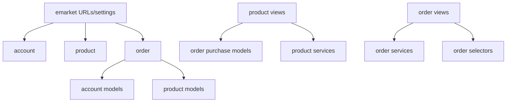

# Architecture

## Principles

The backend is a modular monolith. Domain ownership is explicit, writes are service-led, reads may use selectors, views remain HTTP-oriented, and database constraints are the final safety layer. The design favors understandable Django conventions over framework-like abstractions.

## Dependencies



Cross-domain imports are intentional and point inward to stable model/service contracts. `product.views` reads delivered `OrderItem` records for verified reviews. `order` depends on addresses and variants to perform checkout. There are no circular model imports: product models are independent; order models depend on product models.

## Request lifecycle

1. `emarket/urls.py` prefixes the canonical app URL modules with `/api/v1/`.
2. Simple JWT authenticates the bearer token before the view runs.
3. DRF permissions reject anonymous, non-owner, or non-staff access.
4. A serializer validates request shape and ownership-aware foreign keys.
5. Read endpoints invoke query composition directly or through `selectors.py`.
6. Multi-row writes invoke a service decorated with `transaction.atomic()`.
7. Services acquire deterministic locks, validate current database state, write snapshots and ledgers, and schedule notifications with `transaction.on_commit()`.
8. The view serializes the result and DRF's exception handler returns a consistent error envelope.

## Service boundaries

- `product.services.adjust_inventory`: locked, audited manual stock change.
- `order.services.calculate_quote`: pure-ish database pricing validation; no reservation.
- `order.services.checkout`: idempotent order/stock/coupon/loyalty/payment transaction.
- `transition_order`: state machine and cancellation reversal.
- `collect_cod`: idempotent COD collection and earning trigger.
- `create_return_request`, `decide_return`, `complete_refund`: return/refund lifecycle.
- `adjust_loyalty`: locked staff adjustment and audit.

`order.selectors` contains customer/staff order scoping and aggregate report queries. A selector never mutates state.

## Transaction and locking policy

Checkout locks the user first, then checkout attempt, cart, cart lines, variant rows ordered by primary key, shipping, coupon, and wallet. The user lock serializes same-customer cart/wallet attempts; ordered variant locks avoid inconsistent lock ordering. Cross-customer stock and coupon races converge on their respective locks.

Cancellation, COD collection, return decisions, refund completion, inventory adjustment, password reset confirmation, and loyalty adjustment each have an explicit atomic boundary. SQLite is not accepted as evidence for row-lock behavior.

## Error handling

DRF validation and permission exceptions are wrapped by `emarket.exceptions.api_exception_handler`:

```json
{"error":{"code":"invalid","detail":{"field":["message"]}}}
```

Services raise `ValidationError` for expected business rejection. Unexpected exceptions are not swallowed. Database integrity remains authoritative for races that pass pre-validation.

## Important decisions

- A custom `AbstractUser` is appropriate because the schema is fresh. It preserves username login while enforcing normalized unique email at the database boundary.
- Variant price/stock is authoritative; Product has no competing price or inventory.
- Order and address details are immutable snapshots.
- Stock is deducted at checkout and restored exactly once on cancellation/approved return.
- COD is the only real payment method. Refund status records cash workflow, not gateway evidence.
- Signals are used only for Profile creation, not financial orchestration.

## Adding a feature

1. Write the business rule and ownership matrix.
2. Add/alter models and constraints; create a migration.
3. Add a service for transactional writes or selector for composed reads.
4. Add serializer contract and a thin view.
5. Register the canonical URL.
6. Add model, service, API, negative, and concurrency tests as applicable.
7. Regenerate OpenAPI and update documentation.

New code should not introduce parallel `api_*`, `legacy`, or version-suffixed implementations.
