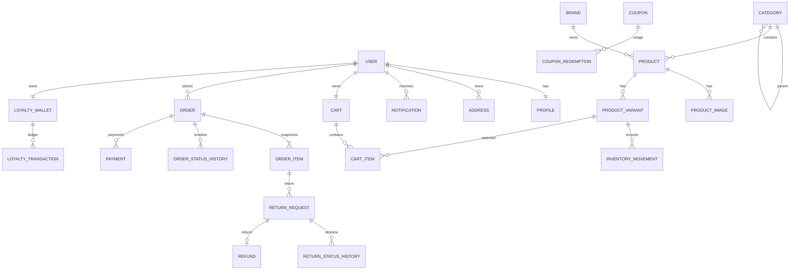

# Database design

PostgreSQL is the reference database. All foreign keys use deliberate deletion policies, money uses `DecimalField`, datetimes are timezone-aware, and important global invariants have database constraints.

## Account models

- `User`: Django `AbstractUser`; nullable email for internal accounts but API registration requires it. Non-empty email is normalized lowercase and database-unique.
- `Profile`: one-to-one phone and hashed password-reset token metadata.
- `Address`: owned delivery address. Partial unique constraint allows at most one default address per user.
- `Notification`: owner-scoped in-app message, indexed by owner/read/time.
- `AuditLog`: append-only staff action record; indexed by action/time.

## Catalog and inventory

- `Category`: unique slug, protected self-parent hierarchy, active state and sort order. Application validation walks ancestors to reject cycles.
- `Brand`: unique name/slug, optional image and description.
- `Product`: protected category/brand links and draft/active/archive state. Index covers status/category/brand.
- `ProductVariant`: unique SKU and per-product normalized option signature; non-negative price; authoritative stock.
- `ProductImage`: ordered media; conditional unique constraint permits one primary image per product.
- `InventoryMovement`: signed non-zero delta, reason, actor and reference. Variant deletion is protected.
- `Review`: one per user/product, rating check 1–5, approval state.
- `WishlistItem`: unique user/product pair.

## Commerce

- `Cart`: one per user. `CartItem` is unique by cart/variant and quantity is positive.
- `ShippingZone`: configured countries/states. `ShippingMethod` has unique code and non-negative flat fee.
- `Coupon`: normalized unique code, type/value/cap/minimum/window/limits and optional product/category eligibility.
- `Order`: user, independent order state, EGP totals, coupon/points/shipping/tax snapshots, JSON address snapshot, reversal flags and stable reference.
- `OrderItem`: immutable product name, SKU, options, unit price, quantity and line total snapshots; variant may later be removed via `SET_NULL`.
- `OrderStatusHistory`: append-only status event.
- `CheckoutAttempt`: unique `(user, key)`, request hash and one resulting order.
- `CouponRedemption`: one per order with release timestamp for cancellation.
- `LoyaltyWallet`: non-negative available balance and outstanding clawback debt.
- `LoyaltyTransaction`: signed balance delta, kind, globally unique event key, order and metadata. Zero delta is allowed for debt-only events.
- `Payment`: persisted COD state, amount/currency and unique transaction reference.
- `ReturnRequest`: item, quantity, reason, decision, stock/refund facts. Positive quantity constraint.
- `ReturnStatusHistory`: append-only return timeline.
- `Refund`: one per return, positive amount, unique reference, pending/completed/rejected cash state.

`PROTECT` is used where deletion would erase commercial meaning. User deletion generally cascades private working data but orders retain nullable historical ownership. Operational records should normally be deactivated rather than deleted.
